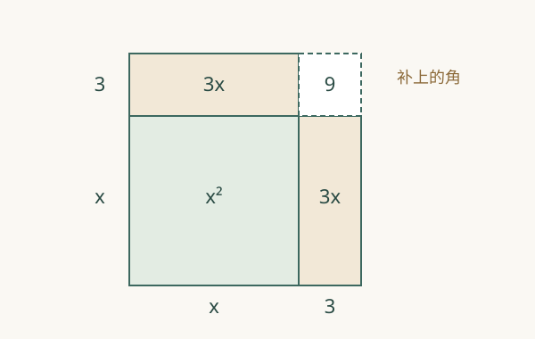

## 不好分解时，下一步怎么办？

求解 \(x^2+6x=7\)。试整数也许能找到 1，但我们想要一种不靠碰运气、也不会漏解的方法。

平方 \((x+3)^2\) 展开是 \(x^2+6x+9\)。原式恰好少了 9：如果能把左边变成平方，问题就会退回已经会解的“一个数平方等于多少”。为什么补的是 9，而不是 6？

## 把长条分成两份

在 \(x>0\) 时，把 \(x^2\) 画成边长为 \(x\) 的正方形；把 \(6x\) 画成两个宽为 3、长为 \(x\) 的长条，分别贴在正方形上边和右边。两条长条围出的外轮廓想成为边长 \(x+3\) 的大正方形，还缺一个 \(3\times3\) 的角。

> **直觉解释：** 图中的长度要求 \(x>0\)，所以它只负责解释“为什么是半个一次项系数的平方”。真正的代数恒等式可以通过展开证明，对所有实数 \(x\) 成立，包括负数。

试着把系数 6 改成 10：两条长条各宽 5，缺角面积应该是 25。一般一次项系数为 \(p\) 时，长条各分到 \(p/2\)，对应补项是 \(p^2/4\)。当 \(p<0\) 时，“贴正面积长条”的图不再合适，仍可使用下面的代数证明。

## 正式说法：配方是一种恒等改写

配方法是利用完全平方恒等式，把二次式改写成一个平方项与常数项之和。关键等式是

\[
x^2+px=\left(x+\frac p2\right)^2-\frac{p^2}{4}.
\]

右边展开后，中间项是 \(2x\cdot p/2=px\)，常数 \(p^2/4\) 与减去的项抵消，剩下原式。这给出了严格理由。

“改写表达式”与“解方程”要区分：表达式里加了多少必须减回多少；方程一边加了多少，另一边也要加多少。它们都在保持原来的数学对象。

## 亲手把方程变成平方

对 \(x^2+6x=7\)，两边都加 9：

\[
x^2+6x+9=16,\qquad (x+3)^2=16.
\]

现在平方的是整个 \(x+3\)，所以 \(x+3=4\) 或 \(x+3=-4\)，得到 \(x=1\) 或 \(x=-7\)。代回原方程，分别为 \(1+6=7\)、\(49-42=7\)。面积图没画出负长度，但代数方法正确保留了负根。

## 从“能算”到“能读图”

把 \(x^2+6x-7\) 改写成 \((x+3)^2-16\)，会暴露图像的中心位置与最低高度。下面演示缩小了参数范围，使用 \(y=(x+2)^2-1\)。固定 \(a=1\)，改变 \(h\)，比较平方里是 \(x-h\) 还是 \(x+h\)。

:::demo
type: quadratic-explorer
a: 1
h: -2
k: -1
:::

这里展开为 \(x^2+4x+3\)，顶点为 \((-2,-1)\)，根为 −3、−1。配方让同一个式子的几何结构更容易读出；这部分会在[二次函数顶点](/articles/quadratic-vertex)继续。

## 三个例子

**简单：** \(x^2+2x=3\)，补 1，得 \((x+1)^2=4\)，根为 1、−3。

**标准：** \(2x^2-8x+3=0\)。先除以非零系数 2：\(x^2-4x=-3/2\)。补 4，得 \((x-2)^2=5/2\)，所以 \(x=2\pm\sqrt{5/2}\)。先把二次项系数化为 1，是为了使用上面的标准恒等式。

**反直觉：** \(x^2+2x+2=0\) 配成 \((x+1)^2=-1\)。配方已经成功，但实数平方不可能负，所以无实数根。方法成功并不保证存在解。

## 反例：只在左边补项会改变问题

把 \(x^2+2x=0\) 写成 \((x+1)^2=0\)，看似完成了平方，实则左边多加了 1，右边没变。原方程的根是 0、−2，错误改写的根却是 −1。正确步骤是 \((x+1)^2=1\)。这个反例暴露了“形式看起来好看”与“等价变形”之间的差别。

## 常见误解

- **“补一次项系数的平方。”** 中间项来自两个相同乘积，先取一半，再平方；\(6x\) 对应补 9，不是 36。
- **“配成平方后只有正号。”** 求解 \(u^2=r>0\) 时 \(u=\pm\sqrt r\)，两种情况都必须保留。
- **“负数不能作为图中长度，因此负根不成立。”** 图是有限的解释工具，代数恒等式才覆盖全部实数。
- **“二次项有系数也直接补 \((b/2)^2\)。”** 先除以 \(a\ne0\)，一次项系数变成 \(b/a\)，再补 \((b/(2a))^2\)。

## 它和哪些知识连接？

本文需要[一元二次方程](/articles/quadratic-equation)里的等式、实数根和乘积结构。配方之后，一条路通向[判别式](/articles/quadratic-discriminant)，判断平方右边的符号；另一条路通向[二次函数顶点](/articles/quadratic-vertex)，寻找最值。它们是同一改写的不同用途。

## 练习

1. 用自己的话说明配方时为什么要把一次项系数“先除以 2”。
2. 在 \(x^2-10x\) 中应补什么？写出恒等改写。
3. 用配方法解 \(x^2-4x=5\)。
4. 用配方法解 \(3x^2+6x-6=0\)。
5. 不求具体根，说明 \(x^2+4x+7=0\) 为什么没有实数解。
6. 如果取消“方程两边加同一个数”的要求，只把 \(x^2-2x=0\) 改成 \((x-1)^2=0\)，原来哪些解被丢掉了？又引入了什么错误解？
7. 已知 \(x\) 为实数，解释为什么 \(x^2-6x+13\) 的最小值是 4；在哪里取得？

## 练习提示

### 题 1
展开 \((x+t)^2\)，看中间项。
### 题 2
一次项系数是 −10，保留符号。
### 题 3
先补 4，两边都补。
### 题 4
先除以 3。
### 题 5
先写成平方加常数。
### 题 6
分别解原方程和被改变的方程。
### 题 7
利用实数平方非负。

## 练习答案

### 题 1
平方展开时出现两个 \(xt\)，合起来是 \(2tx\)。要匹配 \(px\)，就需要 \(t=p/2\)，因此缺少的常数是 \(t^2\)。
### 题 2
补 25，因为 \((-10/2)^2=25\)。恒等改写为 \(x^2-10x=(x-5)^2-25\)。
### 题 3
两边加 4，\((x-2)^2=9\)，所以 \(x=2\pm3\)，根为 5、−1。
### 题 4
除以 3 后 \(x^2+2x=2\)，加 1 后 \((x+1)^2=3\)，得到 \(x=-1\pm\sqrt3\)。
### 题 5
左边等于 \((x+2)^2+3\)，总是至少为 3，不可能等于零。
### 题 6
原式 \(x(x-2)=0\)，根为 0、2。错误方程只有根 1；它丢掉两个原根，加入了原式不满足的 1。正确形式是 \((x-1)^2=1\)。
### 题 7
\(x^2-6x+13=(x-3)^2+4\)。平方项至少为零，且在 \(x=3\) 时确实等于零，所以最小值为 4。下界与能否取到，两点都要说明。

## 如果你真的理解了

- 面积拼图解释了哪一步？哪些实数情形不能直接由图证明？
- 你能区分“表达式中加减抵消”与“等式两边同步改变”吗？
- 为什么同一次配方既能帮助求根，又能帮助找最小值？
- 面对 \(ax^2+bx+c\)，你能解释平方中为什么会出现 \(b/(2a)\) 吗？
