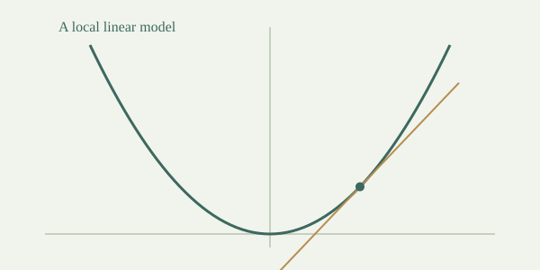

## 先问：变化发生得有多快？

想象你在一条弯曲的道路上行走。**位置**告诉我们你在哪里，**变化率**告诉我们这一刻位置怎样变化。

对于 \(y=f(x)\)，从 \(x\) 到 \(x+h\) 的平均变化率是

\[
\frac{f(x+h)-f(x)}{h},\qquad h\ne0.
\]

它对应连接图像上两个点的割线斜率。它描述的是一段变化，还不是一个点的变化。

## 两个点靠近，割线趋向切线

如果当 \(h\to0\) 时平均变化率有有限的极限，就把这个极限称为导数：

\[
f'(x)=\lim_{h\to0}\frac{f(x+h)-f(x)}{h}.
\]

下面的演示固定一个正弦函数。缩小两点距离，比较割线和切线斜率。拖动观察点，再看同一条曲线在不同位置怎样变化。

:::demo
type: tangent-line
function: sin(x)
x: 1
show_secant: true
h: 1
:::

这里 \(f(x)=\sin x\) 的输入以**弧度**计，导数是 \(\cos x\)。两点距离只能取正值的滑块帮助建立右侧靠近的直觉；导数定义通常要求两侧得到同一极限。

## 更深的一层：局部线性化

如果函数在 \(a\) 可导，那么在 \(a\) 附近，函数可以用一个简单的直线模型描述：

\[
f(a+h)=f(a)+f'(a)h+r(h),\qquad \lim_{h\to0}\frac{r(h)}{h}=0.
\]

这个余项条件说：误差相对于输入变化 \(h\) 更快地趋于零。导数就是这个线性模型中唯一的斜率。

> 可导不仅表示“存在切线”。它还给出一种准确的近似意义：一阶误差比输入变化更小。



## 自己推导一次

以 \(f(x)=x^2\) 为例：

\[
(a+h)^2=a^2+2ah+h^2.
\]

因此局部线性模型是 \(a^2+2ah\)，导数为 \(2a\)，误差是 \(h^2\)。因为 \(h^2/h=h\to0\)，它确实满足刚才的条件。

在 \(a=2\)、\(h=0.1\) 时，近似值为 \(4.4\)，真实值为 \(4.41\)，误差为 \(0.01\)。试着把 \(h\) 减半，比较误差发生了什么。

:::demo
type: tangent-line
function: x^2
x: 1
show_secant: true
h: 0.5
:::

## 一个边界：连续不等于可导

函数 \(f(x)=|x|\) 在 0 连续，但左侧平均变化率为 −1，右侧为 1。没有一个共同的斜率能完成双侧局部线性化，所以它在 0 不可导。[^corner]

## 检查你的理解

1. 函数值是 10，导数是 0，这两条信息矛盾吗？
2. 导数是负数，是否意味着函数值也是负数？
3. 为什么 \(h=0\) 不能直接代入差商？
4. 用自己的话说明，导数怎样提供一个点附近的线性模型。

可以用这段代码核对二次函数近似：

```python
a, h = 2, 0.1
approx = a*a + 2*a*h
actual = (a+h)**2
print(approx, actual, actual-approx)
```

[^corner]: “图像没有尖角”适合初步观察，严格判断仍应回到差商极限或局部线性化条件。
